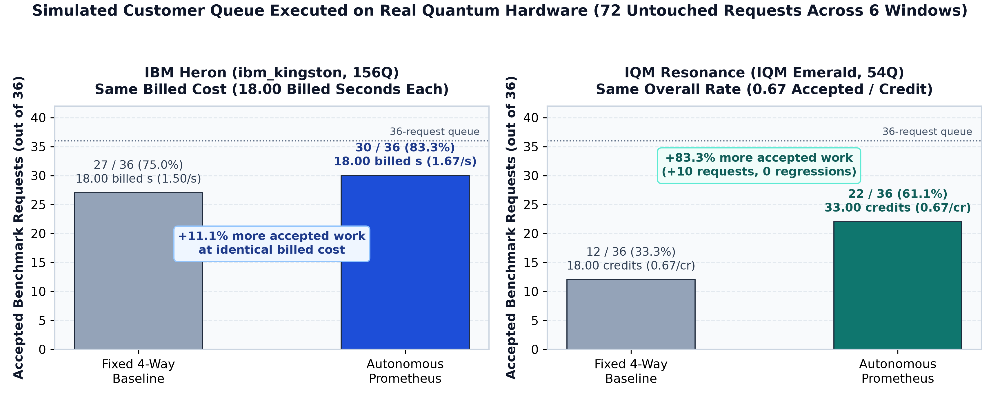
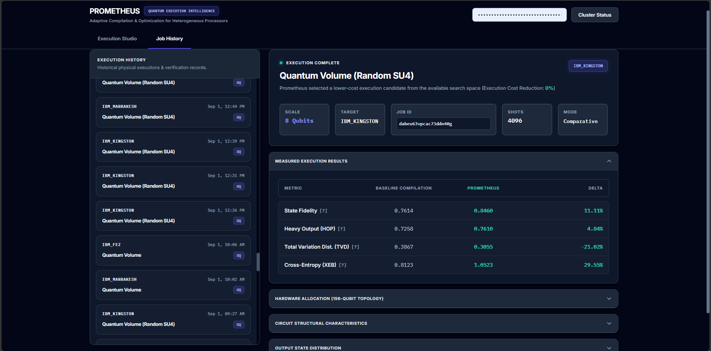
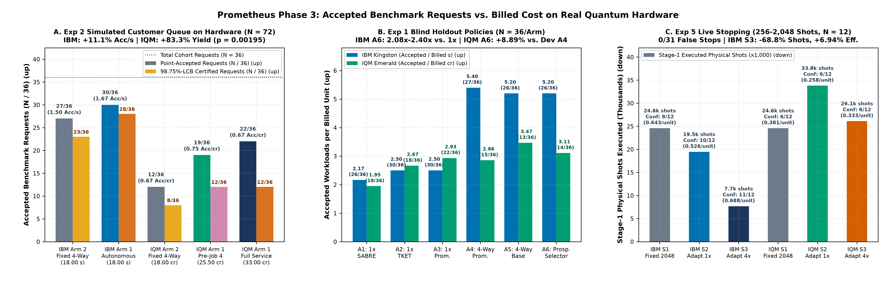

# PROMETHEUS // Quantum Execution Intelligence

Hardware-aware quantum compilation, pre-execution candidate selection, and multi-QPU dispatch across heterogeneous quantum processors.

**Portfolio Scope:** Prometheus operates both as a **hardware-aware quantum compiler** and as a **multi-compiler execution-selection layer** evaluating candidate physical implementations from **Prometheus**, **Qiskit SABRE O3**, and **Quantinuum TKET** across **IBM Quantum** (`ibm_fez`, `ibm_marrakesh`, `ibm_kingston` 156Q Heron r2), **IQM Resonance** (IQM Emerald 54Q, IQM Garnet 20Q), and **Amazon Braket** (Rigetti Cepheus-1-108Q, IQM Garnet 20Q, IQM Emerald 54Q).


---

## Start Here: Getting More Useful Results from Existing Quantum Hardware

### The Customer Problem
Quantum computing teams pay per billed QPU second or per processor credit for cloud hardware whose physical coupler and readout errors vary sharply across chips and drift over hours. Running circuits one at a time with a single default compiler and a fixed shot budget leaves most of a 54-qubit or 156-qubit processor idle, exposes dense circuits to avoidable SWAP overhead, and spends measurement budget on runs that have already converged.

### What Prometheus Does
**Prometheus helps quantum users get more useful results from the hardware they already have - by improving compilation, selecting suitable processors, running compatible workloads together, and stopping measurements when enough evidence has been collected.**

Prometheus combines its own hardware-aware compilation with execution management around **Qiskit SABRE** and **Quantinuum TKET**, evaluating candidate implementations and using workload and hardware information to select how and where to execute them.

| Demonstrated Capability | Why Someone Would Care |
| :--- | :--- |
| **More accepted requests at the same billed cost** | Better productivity from an existing quantum hardware budget |
| **Buffered spatial multiplexing** | More useful work extracted from available processor capacity |
| **Compilation and processor selection** | Better execution choices across cloud processors and existing compilers |
| **Adaptive measurements and refresh decisions** | Less unnecessary QPU and CPU work while pursuing application requirements |

### Three Key Results
1. **More Accepted Requests from a Simulated Customer Queue on Real Hardware ([`Prometheus-Quantum-Execution-Service`](https://github.com/PrometheusDynamicsCanada/Prometheus-Quantum-Execution-Service)):** On IBM Heron, Prometheus completed **30/36** benchmark requests meeting predefined quality targets versus **27/36** with fixed scheduling, at the **same 18.00 provider-billed QPU seconds** (+11.1% per billed second).
   *Supporting metrics:* On IQM Emerald (36 requests), Prometheus completed **22/36 vs. 12/36** (+83.3% accepted requests) at the same overall accepted-requests-per-credit ratio (`0.6667 Acc/credit`; `F_B = 0.8685` vs. 0.8268, request-level `p_Holm = 3.36 × 10⁻⁶`, `K = 12` PUB-cluster CRVE `p = 0.000012`); on IBM, **12/12 vs. 8/12** requests in the strict-policy category met their workload-specific thresholds.
2. **2.85x Higher Throughput per Billed Second via Buffered Spatial Multiplexing ([`Quantum-Execution-Manager-Spatial-Multiplexing`](https://github.com/PrometheusDynamicsCanada/Quantum-Execution-Manager-Spatial-Multiplexing)):** Packing compatible workloads with a two-hop idle qubit buffer (`d_G >= 2`) cut provider-billed QPU time by **57.1%** (3.0 vs. 7.0 billed seconds) and increased qualifying workloads per billed second by **2.85x** on 156-qubit IBM Heron.
   *Supporting metrics:* Across 216 matched same-qubit isolated-vs.-packed controls on IBM Heron, mean overlap differed by `Δ F_B = -0.0012 to +0.0035`; on 54-qubit IQM Emerald ([`IQM-Resonance-Spatial-Multiplexing`](https://github.com/PrometheusDynamicsCanada/IQM-Resonance-Spatial-Multiplexing)), 4-way buffered packing increased throughput by **3.30x per active QPU second** and **3.00x per IQM credit**.
3. **+5.42% to +6.67% Fidelity Gains from Compilation & Processor Selection ([`IBM-Heron-Extended-Validation-1023-Circuits`](https://github.com/PrometheusDynamicsCanada/IBM-Heron-Extended-Validation-1023-Circuits)):** Across 432 circuits on three 156-qubit IBM Heron processors, Prometheus improved mean Squared Hellinger Fidelity F_H by **+5.42%** over Qiskit SABRE O3 (rising to **+6.67%** when paired with pre-execution QPU selection).
   *Supporting metrics:* IBM `F_H = 0.6453` vs. 0.6121 (-12.06% 2Q gates), rising to 0.6846 vs. 0.6418 with QPU dispatch; across 18 logical workloads (216 circuits, 3 calibration windows) on AWS Braket `Rigetti Cepheus-1-108Q` ([`AWS-Braket-Multi-Window-Validation`](https://github.com/PrometheusDynamicsCanada/AWS-Braket-Multi-Window-Validation)), live-calibration compilation improved pooled overlap F_B by **+3.91%** over SABRE O3 (**16/18** workload wins, `p_Holm = 0.0112`) and **+9.03%** over Quantinuum TKET (**15/18** wins, `p_Holm = 0.000641`).

### Service-Level Results & Execution Studio Overview

*Figure 0: Two-bar overview of accepted benchmark requests (`N = 36` per provider) in the simulated customer queue executed on real IBM Heron (18.00 provider-billed QPU seconds per arm) and IQM Emerald (33.00 vs. 18.00 IQM Resonance credits, identical 0.6667 accepted requests per credit).*

[](screenshots/07-qv-execution-result.png)
*Figure 1: Prometheus Execution Studio 3-way compiler comparison (Qiskit SABRE O3 vs. Quantinuum TKET vs. Prometheus) on 9-qubit Dense All-to-All (`K_9`) on `ibm_marrakesh` (Job ID `dadl5jd1ierc738l1420`; overlap F_B: 0.5738 SABRE O3 / 0.5248 TKET / **0.7466 Prometheus [+30.12%]**).*

### Practical Implications for Users and Providers
Teams already using Qiskit SABRE or Quantinuum TKET do not need to replace their existing toolchain to benefit from Prometheus. By evaluating SABRE, TKET, and Prometheus candidates together against live processor telemetry, Prometheus selects the compiler and target QPU best matched to each circuit, packs compatible requests onto buffered subgraphs, and halts converged measurements early.
---

## 1. Executive Summary & Representative Studio Benchmark

> [!NOTE]
> **Metric & UI Conventions:**
> - **Classical Distribution Overlap (F_B, ↑ higher is better) vs. Squared Hellinger Fidelity (F_H = F_B², ↑ higher is better):** F_B(P_ideal, P_meas) = Σ_x √(P_ideal(x) · P_meas(x)); F_H = F_B². Note that the Studio UI label `"State Fidelity [?]"` displays F_B.
> - **Total Variation Distance (TVD, ↓ lower is better):** 0.5 · Σ_x |P_ideal(x) - P_meas(x)|.
> - **Heavy-Output Probability (HOP, ↑ higher is better)** and **Linear Cross-Entropy (XEB, ↑ higher is better)**.

### Table 1A: Multi-Cloud Benchmark Campaign Summary Across the Portfolio

| Benchmark Campaign & Repository | Target Processors | Verified Hardware Scope | Reconciled Headline Outcome |
| :--- | :--- | :--- | :--- |
| **[`Prometheus-Quantum-Execution-Service`](https://github.com/PrometheusDynamicsCanada/Prometheus-Quantum-Execution-Service)** | `ibm_kingston`, `ibm_fez`, `ibm_marrakesh` (156Q), IQM Emerald (54Q), IQM Garnet (20Q) | 308 unseen workloads, 157 provider records (149 bench + 8 aux), 2,509 PUBs, 4,963 evaluations, 2,093,568 shots | **30/36 vs. 27/36 (+11.11%)** accepted IBM requests at identical **18.00 s** billed cost; **22/36 vs. 12/36 (+83.33%)** accepted on IQM Emerald (0.8685 vs. 0.8268 F_B); **0/31** false stops in live adaptive shot stopping (**-68.75%** IBM Stage-1 shots) |
| **[`IQM-Resonance-Spatial-Multiplexing`](https://github.com/PrometheusDynamicsCanada/IQM-Resonance-Spatial-Multiplexing)** | IQM Emerald (54Q), IQM Garnet (20Q) | 59 completed QPU jobs (1,479 physical circuits/PUBs, 1,935 evaluations, 1,135,616 shots) | **+3.73%** workload-averaged F_B vs. SABRE K=8 (0.7389 vs. 0.7123, 39/48 wins) & **16/16 (100%)** wins under matched physical placement; **3.30x** active-second throughput (**3.00x** per credit) at 4-way multiplexing (`120/120 ≥ 0.90`); **99.0%** loss recovery (0.9458 vs. 0.9078) on Stage 4B held-out suite |
| **[`Quantum-Execution-Manager-Spatial-Multiplexing`](https://github.com/PrometheusDynamicsCanada/Quantum-Execution-Manager-Spatial-Multiplexing)** | `ibm_fez`, `ibm_marrakesh`, `ibm_kingston` (156Q) | 19 completed jobs (586 physical PUBs, 1,140 evaluations, 655,360 shots, 220.0 s billed time) | **2.85x** qualifying workloads per billed second (**-57.1%** billed time, 3.0 s vs. 7.0 s) on `ibm_marrakesh`; measured isolated-vs.-packed differences **Δ F_B = -0.0012 to +0.0035** across 216 paired controls; TKET buffered 8-way packing improves F_B by **+0.0031** over isolated TKET (`p = 0.0117`) |
| **[`IBM-Heron-Extended-Validation-1023-Circuits`](https://github.com/PrometheusDynamicsCanada/IBM-Heron-Extended-Validation-1023-Circuits)** | `ibm_fez`, `ibm_marrakesh`, `ibm_kingston` (156Q) | 17 batch jobs (1,023 physical circuits, 1,047,552 shots, 326.0 s billed time) | **+5.42%** mean F_H (0.6453 vs. 0.6121 SABRE O3; **+3.27%** F_B, 0.7838 vs. 0.7590, **-12.06%** 2Q gates) across 432 Pillar 1A circuits, expanding to **+6.67%** F_H (0.6846 vs. 0.6418) with pre-execution QPU dispatch; **0.5379 vs. 0.3801** polarization (+41.53%) at 101Q Clifford mirrors |
| **[`AWS-Braket-Multi-Window-Validation`](https://github.com/PrometheusDynamicsCanada/AWS-Braket-Multi-Window-Validation)** | Rigetti Cepheus-1-108Q (108Q) | 10 `ProgramSet` tasks (450 physical circuits, 460,800 shots across 3 calibration windows) | **+3.91%** 3-window workload-averaged F_B (0.5232 vs. 0.5035 SABRE O3, p_Holm = 0.0112) and **+9.03%** vs. TKET (0.4799, p_Holm = 0.000641), with **-13.36%** fewer 2Q gates and **-23.56%** lower depth; **+6.61%** vs. SABRE O3 (0.5398 vs. 0.5063) in Window 3 post-recalibration |
| **[`IBM-Heron-156Q-Benchmarks`](https://github.com/PrometheusDynamicsCanada/IBM-Heron-156Q-Benchmarks)** | `ibm_marrakesh`, `ibm_fez`, `ibm_kingston` (156Q) | 10 packed `SamplerV2` jobs (441 physical circuits, 755,712 shots: 297 in 99 tournaments + 144 pre-committed) | **65/99 (65.7%)** pairwise wins vs. SABRE O3, **89/99 (89.9%)** pairwise wins vs. TKET, and **62/99 (62.6%)** simultaneous 3-way tournament wins across 3Q-13Q sweep & 9Q 15-family matrix; **16/18 (88.9%)** primary metric wins vs. SABRE O3 (15/18 vs. TKET) on pre-committed suite |
| **[`Hybrid-Quantum-HPC-Benchmarks`](https://github.com/PrometheusDynamicsCanada/Hybrid-Quantum-HPC-Benchmarks)** | 3 IBM Heron (156Q), Rigetti (108Q), 2 IQM (20Q/54Q) + Classical NVIDIA H100 | 119 completed 3-way QPU jobs/tasks (357 circuits, 5,084,160 shots) + 150 separate H100 GPU runs | **80/107 (74.8%)** pairwise wins vs. SABRE O3 and **100/107 (93.5%)** vs. TKET on Heron (4Q-23Q); **9/12** fidelity wins and **12/12 (100.0%)** depth & 2Q gate reductions on Braket; separate `72 -> 4` QUBO compression & 5.26 s 1,029-variable H100 schedule |



*Figure 2: Detailed three-panel technical breakdown from [`Prometheus-Quantum-Execution-Service`](https://github.com/PrometheusDynamicsCanada/Prometheus-Quantum-Execution-Service): (A) simulated customer queue (`N = 72`), (B) separately billed prospective policy selector (`N = 36/arm`), and (C) sequentially valid live shot stopping (256-2,048 shots, 0/31 false stops).*

### Table 1B: Representative 3-Way Studio Execution - 9-Qubit Dense All-to-All (K_9) on `ibm_marrakesh` (Job ID: `dadl5jd1ierc738l1420`, 4,096 Shots/Compiler)

| Metric & Direction | Qiskit SABRE O3 | Quantinuum TKET | Prometheus | Prometheus vs. Best Baseline |
| :--- | ---: | ---: | ---: | ---: |
| **Compiled Circuit Depth (↓)** | 145 | 165 | **109** | **-24.83%** |
| **Native Two-Qubit CZ Gates (↓)** | 90 | 123 | **74** | **-17.78%** |
| **Distribution Fidelity F_B (↑)** *(Studio UI: "State Fidelity")* | 0.5738 | 0.5248 | **0.7466** | **+30.12%** |
| **Heavy-Output Probability HOP (↑)** | 0.6975 | 0.7339 | **0.8425** | **+14.80%** |
| **Total Variation Distance TVD (↓)** | 0.4572 | 0.5241 | **0.3015** | **-34.04%** |
| **Linear Cross-Entropy XEB (↑)** | 38.3213 | 31.1110 | **50.1079** | **+30.76%** |

[](screenshots/07-qv-execution-result.png)

*Figure 3: Prometheus Execution Studio 3-Way Comparative Benchmark (SABRE O3 vs. TKET vs. Prometheus) on 9-Qubit Dense All-to-All (K_9), executed on `ibm_marrakesh` (Job ID: `dadl5jd1ierc738l1420`, 4,096 shots/compiler = 12,288 total shots).*

---

## 2. Core Execution Workflow & Repository Guide

```text
Logical Quantum Circuit (OpenQASM 2.0 / 3.0)
        |
        +---> Prometheus Hardware-Aware Compiler
        +---> Qiskit SABRE O3 Baseline
        +---> Quantinuum TKET Baseline
                    |
                    v
   Physical Candidate Verification & Calibration Scoring
                    |
                    v
   Pre-Execution Candidate & Target-QPU Selection
                    |
                    v
   Packed Hardware Execution (IBM SamplerV2 / AWS Braket ProgramSet / IQM Resonance)
                    |
                    v
   Canonical Logical Measurement Recovery & Offline Scoring
```

- **[`SCREENSHOT_GALLERY.md`](SCREENSHOT_GALLERY.md)** - Complete 18-screenshot visual walkthrough of Prometheus Studio (01-06: Configuration; 07-10: 9Q Dense All-to-All 3-Way Benchmark `dadl5jd1ierc738l1420`; 11: 8Q Quantum Volume `dabeu63vpcac73ddn40g`; 12-14: 9Q Repeated-Run Drift Controls; 15-18: 12Q-16Q Dense All-to-All Comparisons).
- **[`results/RESULTS.md`](results/RESULTS.md)** & **[`demonstrations/DEMONSTRATIONS.md`](demonstrations/DEMONSTRATIONS.md)** - Detailed metric tables and Job ID index for the Studio screenshots.
- **[`ARCHITECTURE.md`](ARCHITECTURE.md)** - Multi-compiler candidate evaluation and multi-QPU dispatch architecture.
- **[`PROJECT_DIRECTION.md`](PROJECT_DIRECTION.md)** - Cross-paradigm roadmap across superconducting, trapped-ion, and neutral-atom processors.
- **[`PORTFOLIO_ACCOUNTING_LEDGER.json`](PORTFOLIO_ACCOUNTING_LEDGER.json)** & **[`scripts/verify_portfolio_accounting.py`](scripts/verify_portfolio_accounting.py)** - Single authoritative cross-repository accounting and Job-ID deduplication ledger (405 unique provider Job IDs / Task ARNs across 10 quantum repositories, 0 cross-campaign duplicates).
- **[`PUBLIC_DISCLOSURE.md`](PUBLIC_DISCLOSURE.md)** - Five verification tiers across the portfolio (raw shot/`BitArray` payload reconstruction vs. outcome-ledger arithmetic/CRVE statistical audit vs. `LF`-normalized byte checksums vs. private-artifact reference digests vs. local runner serialization timestamps), withheld internals, and historical GitHub server-cache notice.

---

## 3. Prometheus Dynamics Public Repository Portfolio (10 Quantum Repositories | 405 Provider Records [397 Benchmark Jobs] | 7,619 Physical Circuits/PUBs | 15,358,208 Physical Shots)

**Portfolio Totals (10 Quantum Repositories - Authoritative Deduplicated Ledger: [`PORTFOLIO_ACCOUNTING_LEDGER.json`](https://github.com/PrometheusDynamicsCanada/prometheus-execution-intelligence/blob/main/PORTFOLIO_ACCOUNTING_LEDGER.json)):** 405 Unique Provider QPU Job/Task Records (**397 Completed Benchmark Jobs/Tasks** + 8 Scheduled Warm-Up/Troubleshooting Records: 238 IBM Heron Jobs [236 bench + 2 aux], 22 AWS Braket `ProgramSet` Tasks, and 145 IQM Resonance Jobs [139 bench + 6 aux]) | **7,619 Physical Circuits/PUBs** | **15,358,208 Physical Measurement Shots**

Counts refer to completed public hardware executions reconciled in [`PORTFOLIO_ACCOUNTING_LEDGER.json`](https://github.com/PrometheusDynamicsCanada/prometheus-execution-intelligence/blob/main/PORTFOLIO_ACCOUNTING_LEDGER.json) (`python scripts/verify_portfolio_accounting.py`, confirming 405 unique provider Job IDs / Task ARNs with 0 cross-campaign duplicates), excluding simulations, classical GPU runs, unrecovered queue dispatches, and two setup smoke tests. Shared datasets are counted once: the shared 4-job (144-circuit, 147,456-shot) pre-committed validation suite is counted in `IBM-Heron-156Q-Benchmarks`, and all 33 archived job ZIP bundles (99 circuits, 1,622,016 shots) in `qpu-selection-execution-quality` already occur in the 107-job historical IBM Heron corpus (`Hybrid-Quantum-HPC-Benchmarks`). The telemetry archive (`prometheus-quantum-telemetry`) contributes 774 PUBs and 4,125,440 physical shots across 14 jobs, and the execution service (`Prometheus-Quantum-Execution-Service`) contributes 157 provider records (149 benchmark jobs + 8 auxiliary records), 2,509 PUBs, and 2,093,568 physical shots across 308 disjoint unseen workloads. Physical multiplexed shots are not multiplied by the number of component workloads.

| Repository | Practical Focus & Reconciled Hardware Scope | Primary Verification Artifacts |
| :--- | :--- | :--- |
| **[`prometheus-execution-intelligence`](https://github.com/PrometheusDynamicsCanada/prometheus-execution-intelligence)** | **Portfolio Front Door, Authoritative Accounting Ledger & System Architecture:** How Prometheus works alongside Qiskit SABRE and Quantinuum TKET across 6 cloud QPUs, leading with integrated service-level results, verification-tier documentation, and the single authoritative 405-ID cross-repository deduplication ledger (397 benchmark jobs + 8 auxiliary records, 7,619 PUBs, 15,358,208 physical shots). | [`PORTFOLIO_ACCOUNTING_LEDGER.json`](https://github.com/PrometheusDynamicsCanada/prometheus-execution-intelligence/blob/main/PORTFOLIO_ACCOUNTING_LEDGER.json), [`PUBLIC_DISCLOSURE.md`](https://github.com/PrometheusDynamicsCanada/prometheus-execution-intelligence/blob/main/PUBLIC_DISCLOSURE.md), `scripts/verify_portfolio_accounting.py` |
| **[`Prometheus-Quantum-Execution-Service`](https://github.com/PrometheusDynamicsCanada/Prometheus-Quantum-Execution-Service)** | **Autonomous Quantum Execution Service (Phases 1-3):** 308 disjoint unseen workloads, 157 provider records (149 benchmark QPU jobs + 8 warm-up/troubleshooting records: 71 IBM Heron + 86 IQM Resonance), 2,509 physical PUBs, 4,963 workload evaluations, and 2,093,568 physical shots (**30/36 vs. 27/36** accepted requests on IBM at identical **18.00 s** provider-billed QPU time and **22/36 vs. 12/36** on IQM in a simulated customer queue executed on real quantum hardware; **0/31** false stops in live adaptive shot halting). | [`reports/prometheus_phase3_capstone_evidence_release.md`](https://github.com/PrometheusDynamicsCanada/Prometheus-Quantum-Execution-Service/blob/main/reports/prometheus_phase3_capstone_evidence_release.md), [`scripts/verify_execution_service_campaign.py`](https://github.com/PrometheusDynamicsCanada/Prometheus-Quantum-Execution-Service/blob/main/scripts/verify_execution_service_campaign.py) |
| **[`IQM-Resonance-Spatial-Multiplexing`](https://github.com/PrometheusDynamicsCanada/IQM-Resonance-Spatial-Multiplexing)** | **IQM Emerald (54Q) Dense-Circuit Compilation & Spatial Multiplexing:** 59 completed QPU jobs (1,479 physical circuits/PUBs, 1,935 workload evaluations, 1,135,616 physical shots): 19-job Dense-Circuit K=8 Optimization & Matched-Placement Campaign (739 circuits, 756,736 shots, **+3.73%** vs. SABRE K=8, **16/16** matched-layout wins) + 40-job Spatial Multiplexing & Duration Scheduler Campaign (740 PUBs, 1,196 evaluations, **3.30x** 4-way active-second throughput, **3.00x** per credit, **99.0%** loss recovery). | [`data/dense_campaign_stages2_3_4_results.json`](https://github.com/PrometheusDynamicsCanada/IQM-Resonance-Spatial-Multiplexing/blob/main/data/dense_campaign_stages2_3_4_results.json), [`data/stage2_emerald_replication_results.json`](https://github.com/PrometheusDynamicsCanada/IQM-Resonance-Spatial-Multiplexing/blob/main/data/stage2_emerald_replication_results.json), [`scripts/verify_iqm_resonance_ledger.py`](https://github.com/PrometheusDynamicsCanada/IQM-Resonance-Spatial-Multiplexing/blob/main/scripts/verify_iqm_resonance_ledger.py) |
| **[`Quantum-Execution-Manager-Spatial-Multiplexing`](https://github.com/PrometheusDynamicsCanada/Quantum-Execution-Manager-Spatial-Multiplexing)** | **IBM Heron 8-Way Spatial Multiplexing & Multi-Compiler Selection:** 19 completed IBM Heron jobs (586 physical PUBs, 1,140 workload evaluations, 655,360 physical shots, 220.0 s provider-billed QPU time) across `ibm_fez`, `ibm_marrakesh`, and `ibm_kingston` (**2.85x** qualifying workloads per billed second, **-57.1%** billed time, and SABRE/TKET/Prometheus interoperability). | [`data/campaign3_compiler_interoperability_results.json`](https://github.com/PrometheusDynamicsCanada/Quantum-Execution-Manager-Spatial-Multiplexing/blob/main/data/campaign3_compiler_interoperability_results.json), [`scripts/verify_spatial_multiplexing_campaigns.py`](https://github.com/PrometheusDynamicsCanada/Quantum-Execution-Manager-Spatial-Multiplexing/blob/main/scripts/verify_spatial_multiplexing_campaigns.py) |
| **[`AWS-Braket-Multi-Window-Validation`](https://github.com/PrometheusDynamicsCanada/AWS-Braket-Multi-Window-Validation)** | **Rigetti Cepheus-1-108Q 3-Window Replication & Equal-Budget Controls:** 10 AWS Braket `ProgramSet` tasks (450 physical circuits, 460,800 physical shots) across 3 calibration windows (**0.5232** vs. 0.5035 SABRE O3 [**+3.91%**, **16/18** workload wins, p_Holm = 0.0112] and 0.4799 TKET [**+9.03%**, **15/18** wins, p_Holm = 0.000641]; **0.5398** vs. 0.5063 [**+6.61%**] after Window 3 recalibration). | [`data/ALL_450_RIGETTI_CIRCUITS_RESULTS.csv`](https://github.com/PrometheusDynamicsCanada/AWS-Braket-Multi-Window-Validation/blob/main/data/ALL_450_RIGETTI_CIRCUITS_RESULTS.csv), [`scripts/verify_braket_campaign.py`](https://github.com/PrometheusDynamicsCanada/AWS-Braket-Multi-Window-Validation/blob/main/scripts/verify_braket_campaign.py) |
| **[`IBM-Heron-Extended-Validation-1023-Circuits`](https://github.com/PrometheusDynamicsCanada/IBM-Heron-Extended-Validation-1023-Circuits)** | **4-Pillar Extended IBM Heron r2 Stress Test (1,023 Circuits):** 17 batch jobs (1,023 physical circuits, 1,047,552 physical shots, 326.0 s provider-billed QPU time) across `ibm_marrakesh`, `ibm_fez`, and `ibm_kingston` (**0.6453** vs. 0.6121 SABRE O3 F_H [**+5.42%**] in Pillar 1A, **0.6846** vs. 0.6418 [**+6.67%**] with QPU dispatch, 8Q-101Q Clifford mirrors, and 453-seed equal-CPU-budget controls). | [`ALL_1023_CIRCUITS_RESULTS.csv`](https://github.com/PrometheusDynamicsCanada/IBM-Heron-Extended-Validation-1023-Circuits/blob/main/ALL_1023_CIRCUITS_RESULTS.csv), [`scripts/verify_campaign.py`](https://github.com/PrometheusDynamicsCanada/IBM-Heron-Extended-Validation-1023-Circuits/blob/main/scripts/verify_campaign.py) |
| **[`IBM-Heron-156Q-Benchmarks`](https://github.com/PrometheusDynamicsCanada/IBM-Heron-156Q-Benchmarks)** | **156Q Heron r2 Scaling (3Q-13Q), 9Q 15-Algorithm Matrix & Pre-Committed Suite:** 10 packed `SamplerV2` batch jobs (441 physical circuits, 755,712 shots) across `ibm_fez`, `ibm_marrakesh`, and `ibm_kingston` (**65/99 [65.7%]** pairwise wins vs. SABRE O3, **89/99 [89.9%]** vs. TKET, **62/99 [62.6%]** 3-way tournament wins; **16/18 [88.9%]** pre-committed suite wins). | [`data/heron_156q_99tournaments_297circuits.csv`](https://github.com/PrometheusDynamicsCanada/IBM-Heron-156Q-Benchmarks/blob/main/data/heron_156q_99tournaments_297circuits.csv), [`validation_suite_144_executions/`](https://github.com/PrometheusDynamicsCanada/IBM-Heron-156Q-Benchmarks/tree/main/validation_suite_144_executions), `scripts/verify_ledger.py` |
| **[`qpu-selection-execution-quality`](https://github.com/PrometheusDynamicsCanada/qpu-selection-execution-quality)** | **Cross-QPU Compiler Arbitration & Cryptographic Provenance:** 33 archived IBM Quantum job ZIP bundles (99 physical circuits, 1,622,016 shots across 16Q-23Q, also in the 107-job historical corpus) plus the shared 4-job (144-circuit) pre-committed suite, showing **2.75x** cross-QPU fidelity spread on 20Q Dense All-to-All (0.0981 vs. 0.0357 F_B) and processor-dependent compiler rankings at 21Q-22Q. | [`EVIDENCE_INDEX.md`](https://github.com/PrometheusDynamicsCanada/qpu-selection-execution-quality/blob/main/EVIDENCE_INDEX.md), [`REPOSITORY_SHA256SUMS.txt`](https://github.com/PrometheusDynamicsCanada/qpu-selection-execution-quality/blob/main/REPOSITORY_SHA256SUMS.txt), `Fez_Marrakesh_Kingston/3_verify_and_view.py` |
| **[`prometheus-quantum-telemetry`](https://github.com/PrometheusDynamicsCanada/prometheus-quantum-telemetry)** | **Empirical Routing & Gate-Cost Boundaries (Experiments 01-05):** 14 IBM Heron jobs (774 physical PUBs, 4,125,440 physical shots) measuring where calibration-aware routing improved fidelity on tested workloads (**30/40 [75.0%]** randomized `6Q-9Q` instances on `ibm_marrakesh`, **67%** of conditional `6Q-7Q` QAOA comparisons on `ibm_marrakesh`) and where added two-qubit gate overhead reduced fidelity (10/40 randomized instances, tested `ibm_fez`/`ibm_kingston` sectors, and `10Q` scaling instances). | [`IBM_JOB_EVIDENCE_INDEX.csv`](https://github.com/PrometheusDynamicsCanada/prometheus-quantum-telemetry/blob/main/IBM_JOB_EVIDENCE_INDEX.csv), [`MASTER_RESULTS.csv`](https://github.com/PrometheusDynamicsCanada/prometheus-quantum-telemetry/blob/main/MASTER_RESULTS.csv), `verify_sha256_evidence.py` |
| **[`Hybrid-Quantum-HPC-Benchmarks`](https://github.com/PrometheusDynamicsCanada/Hybrid-Quantum-HPC-Benchmarks)** | **Coordinating Quantum Execution with Classical Computing:** 119 completed 3-way QPU jobs/tasks (357 circuits, 5,084,160 shots: 107 IBM Heron [321 circuits, 4,964,352 shots] + 12 AWS Braket across Rigetti & IQM [36 circuits, 119,808 shots]) and the shared 4-job (144-circuit, 147,456-shot) suite, kept visibly separate from 150 classical GPU runs (`VeloxQ NVIDIA H100`, 4 to 1,029 binary variables, `72 -> 4` variable compression). | [`aws_braket_qpu_12_jobs_ledger.json`](https://github.com/PrometheusDynamicsCanada/Hybrid-Quantum-HPC-Benchmarks/blob/main/aws_braket_qpu_12_jobs_ledger.json), [`ibm_heron_156q_verified_benchmarks.json`](https://github.com/PrometheusDynamicsCanada/Hybrid-Quantum-HPC-Benchmarks/blob/main/ibm_heron_156q_verified_benchmarks.json), [`veloxq_h100_hybrid_benchmarks.json`](https://github.com/PrometheusDynamicsCanada/Hybrid-Quantum-HPC-Benchmarks/blob/main/veloxq_h100_hybrid_benchmarks.json), `verify_corpus_and_schedules.py` |

*(Separate Infrastructure Security Repository: **[`argus-benchmarks`](https://github.com/PrometheusDynamicsCanada/argus-benchmarks)** documents standalone Linux XDP/eBPF origin connection-flood protection across 4, 18, and 48 USD/month cloud droplets and is independent of the quantum execution portfolio above.)*
