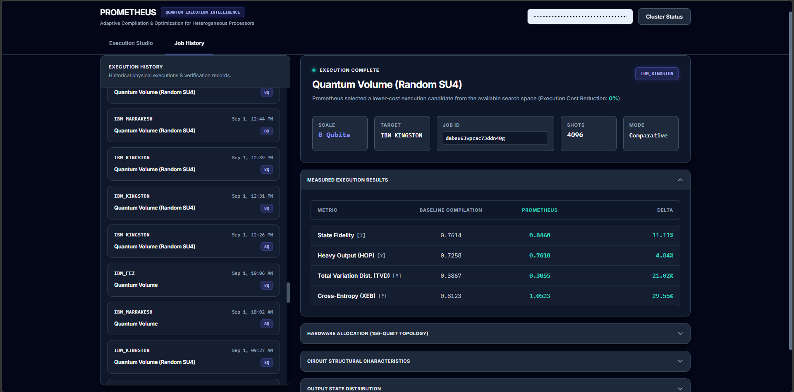

# PROMETHEUS // Quantum Execution Intelligence

**Hardware-aware quantum compilation, pre-execution candidate selection, and multi-QPU dispatch across heterogeneous quantum processors.**

Prometheus operates both as a **hardware-aware quantum compiler** and as a **multi-compiler execution-selection layer** evaluating candidate physical implementations from **Prometheus**, **Qiskit SABRE O3**, and **Quantinuum TKET** across **IBM Quantum (`ibm_fez`, `ibm_marrakesh`, `ibm_kingston` 156Q Heron r2)** and **Amazon Braket (`Rigetti Cepheus-1-108Q`, `IQM Garnet` 20Q, `IQM Emerald` 54Q)**.

---

## Key Empirical Summary & Representative Studio Benchmark

| Benchmark Campaign | Target Processors | Scope & Sample Size | Summary Outcome |
| :--- | :--- | :--- | :--- |
| **Pre-Committed 144-Execution Suite** | `ibm_marrakesh`, `ibm_fez`, `ibm_kingston` *(156Q)* | `4` packed `SamplerV2` jobs (`144` circuits, `147,456` shots, `48.0s` QPU time) | **`16 / 18` (`88.9%`)** primary metric wins vs. `SABRE O3`, **`15 / 18` (`83.3%`)** vs. `TKET`, **`6 / 6` (`100%`)** at `12Q`, and **`6 / 6`** multi-QPU dispatch wins vs. Fixed Marrakesh/Fez (`5 / 6` vs. Fixed Kingston) |
| **Heron r2 Odd/Even & 15-Family Matrix** | `ibm_fez`, `ibm_marrakesh`, `ibm_kingston` *(156Q)* | `6` packed `SamplerV2` jobs (`99` tournaments / `297` circuits, `608,256` shots) | **`38 / 54` (`70.4%`)** fidelity $F_B$ (↑) wins vs. `SABRE O3` (`90.7%` vs. `TKET`) on `3Q`-`13Q` scaling; **`65 / 99` (`65.7%`)** vs. `SABRE O3` (`89.9%` vs. `TKET`) combined |
| **156Q Gate-QPU Compilation Corpus** | `ibm_marrakesh`, `ibm_fez`, `ibm_kingston` *(156Q)* | `107` completed 3-way jobs (`321` circuits, `4,964,352` shots across `4Q`-`23Q`) | **`80 / 107` (`74.8%`)** wins vs. `SABRE O3` and **`100 / 107` (`93.5%`)** wins vs. `TKET` |
| **Amazon Braket Live QPU Corpus** | `Rigetti Cepheus-1-108Q`, `IQM Garnet` (20Q), `IQM Emerald` (54Q) | `12` completed 3-way `ProgramSet` tasks (`36` verbatim circuits, `119,808` shots) | **`12 / 12` (`100%`)** lower depth (↓) & 2Q `CZ` count (↓) vs. both baselines; **`9 / 12` (`75.0%`)** distribution fidelity $F_B$ (↑) wins vs. `SABRE O3` |

### Representative 3-Way Studio Execution: 9-Qubit Dense All-to-All ($K_9$) on `ibm_marrakesh` (`Job ID: dadl5jd1ierc738l1420`, `4,096` Shots/Compiler)

| Metric | Qiskit SABRE O3 | Quantinuum TKET | Prometheus | Prometheus vs. Best Baseline |
| :--- | ---: | ---: | ---: | ---: |
| **Compiled Circuit Depth (↓)** | 145 | 165 | **109** | **-24.83%** |
| **Native Two-Qubit `CZ` Gates (↓)** | 90 | 123 | **74** | **-17.78%** |
| **Distribution Fidelity $F_B$ (↑)** *(UI: "State Fidelity")* | 0.5738 | 0.5248 | **0.7466** | **+30.12%** |
| **Heavy-Output Probability HOP (↑)** | 0.6975 | 0.7339 | **0.8425** | **+14.80%** |
| **Total Variation Distance TVD (↓)** | 0.4572 | 0.5241 | **0.3015** | **-34.04%** |
| **Linear Cross-Entropy XEB (↑)** | 38.3213 | 31.1110 | **50.1079** | **+30.76%** |

[](screenshots/07-qv-execution-result.png)
*Figure 1: Prometheus Execution Studio 3-Way Comparative Benchmark (`SABRE O3` vs. `TKET` vs. `Prometheus`) on 9-Qubit Dense All-to-All ($K_9$), executed on `ibm_marrakesh` (`Job ID: dadl5jd1ierc738l1420`, `4,096` shots/compiler = `12,288` total shots). Note: The Studio UI label `"State Fidelity [?]"` displays Classical Computational-Basis Distribution Fidelity (Bhattacharyya overlap $F_B = \sum_x \sqrt{P_{\text{ideal}}(x) P_{\text{meas}}(x)}$ ↑).*

---

## Core Execution Workflow

```text
Logical Quantum Circuit (OpenQASM 2.0 / 3.0)
        |
        +---> Prometheus Hardware-Aware Compiler
        +---> Qiskit SABRE O3 Baseline
        +---> Quantinuum TKET Baseline
                    |
                    v
   Physical Candidate Verification & Calibration Scoring
                    |
                    v
   Pre-Execution Candidate & Target-QPU Selection
                    |
                    v
   Packed Hardware Execution (IBM SamplerV2 / AWS Braket ProgramSet)
                    |
                    v
   Canonical Logical Measurement Recovery & Offline Scoring
```

---

## Repository Guide

- **[`SCREENSHOT_GALLERY.md`](SCREENSHOT_GALLERY.md)** - Complete 18-screenshot visual walkthrough of Prometheus Studio (`01`-`06`: Configuration; `07`-`10`: 9Q Dense All-to-All 3-Way Benchmark `dadl5jd1ierc738l1420`; `11`: 8Q Quantum Volume `dabeu63vpcac73ddn40g`; `12`-`14`: 9Q Repeated-Run Drift Controls; `15`-`18`: 12Q-16Q Dense All-to-All Comparisons).
- **[`results/RESULTS.md`](results/RESULTS.md)** & **[`demonstrations/DEMONSTRATIONS.md`](demonstrations/DEMONSTRATIONS.md)** - Detailed metric tables and Job ID index for the Studio screenshots.
- **[`ARCHITECTURE.md`](ARCHITECTURE.md)** - Multi-compiler candidate evaluation and multi-QPU dispatch architecture.
- **[`PROJECT_DIRECTION.md`](PROJECT_DIRECTION.md)** - Cross-paradigm roadmap across superconducting, trapped-ion, and neutral-atom processors.
- **[`PUBLIC_DISCLOSURE.md`](PUBLIC_DISCLOSURE.md)** - Public verification artifacts vs. protected compiler internals.

---

## Prometheus Dynamics Public Repository Portfolio

| Repository | Scope & Empirical Dataset | Primary Verification Artifacts |
| :--- | :--- | :--- |
| **[`Hybrid-Quantum-HPC-Benchmarks`](https://github.com/PrometheusDynamicsCanada/Hybrid-Quantum-HPC-Benchmarks)** | **Multi-Cloud QPU & Hybrid GPU Corpus:** `12` live Amazon Braket `ProgramSet` tasks (`Rigetti Cepheus-1-108Q`, `IQM Garnet` 20Q, `IQM Emerald` 54Q), `107` IBM Heron 3-way jobs (`4Q`-`23Q`), `144`-execution pre-committed validation suite (`48.0s` QPU time), and `150` NVIDIA H100 (`VeloxQH100_1`) QUBO runs (`4` to `1,029` variables). | [`aws_braket_qpu_12_jobs_ledger.json`](https://github.com/PrometheusDynamicsCanada/Hybrid-Quantum-HPC-Benchmarks/blob/main/aws_braket_qpu_12_jobs_ledger.json), [`ibm_heron_156q_verified_benchmarks.json`](https://github.com/PrometheusDynamicsCanada/Hybrid-Quantum-HPC-Benchmarks/blob/main/ibm_heron_156q_verified_benchmarks.json), [`validation_suite_144_executions/`](https://github.com/PrometheusDynamicsCanada/Hybrid-Quantum-HPC-Benchmarks/tree/main/validation_suite_144_executions), `verify_corpus_and_schedules.py` |
| **[`IBM-Heron-156Q-Benchmarks`](https://github.com/PrometheusDynamicsCanada/IBM-Heron-156Q-Benchmarks)** | **156Q Heron r2 Scaling & Pre-Committed Suite:** `10` packed `SamplerV2` batch jobs (`441` physical circuits, `755,712` shots) across `ibm_fez`, `ibm_marrakesh`, and `ibm_kingston` covering `3Q`-`13Q` odd/even parity scaling, a `15-algorithm` matrix at `9Q`, and the `144-execution` pre-committed validation suite. | [`data/heron_156q_99tournaments_297circuits.csv`](https://github.com/PrometheusDynamicsCanada/IBM-Heron-156Q-Benchmarks/blob/main/data/heron_156q_99tournaments_297circuits.csv), [`validation_suite_144_executions/`](https://github.com/PrometheusDynamicsCanada/IBM-Heron-156Q-Benchmarks/tree/main/validation_suite_144_executions), `scripts/verify_ledger.py` |
| **[`qpu-selection-execution-quality`](https://github.com/PrometheusDynamicsCanada/qpu-selection-execution-quality)** | **Cryptographic Provenance & Cross-QPU Arbitration:** Archived IBM Quantum job ZIP bundles and `SHA-256` manifests (`16Q`-`23Q` dense all-to-all across `ibm_fez`, `ibm_kingston`, and `ibm_marrakesh`). | [`EVIDENCE_INDEX.md`](https://github.com/PrometheusDynamicsCanada/qpu-selection-execution-quality/blob/main/EVIDENCE_INDEX.md), [`REPOSITORY_SHA256SUMS.txt`](https://github.com/PrometheusDynamicsCanada/qpu-selection-execution-quality/blob/main/REPOSITORY_SHA256SUMS.txt), `Fez_Marrakesh_Kingston/3_verify_and_view.py` |
| **[`prometheus-quantum-telemetry`](https://github.com/PrometheusDynamicsCanada/prometheus-quantum-telemetry)** | **Mechanistic Operating Envelope (`01`-`05`):** Distributional concentration (`100k` shots/circuit), `40` randomized matched pairs, `3Q`-`10Q` scaling boundaries, `13Q` ground-state avoidance, and a `540`-PUB (`1.11M`-shot) 3-QPU sweep. | [`IBM_JOB_EVIDENCE_INDEX.csv`](https://github.com/PrometheusDynamicsCanada/prometheus-quantum-telemetry/blob/main/IBM_JOB_EVIDENCE_INDEX.csv), [`MASTER_RESULTS.csv`](https://github.com/PrometheusDynamicsCanada/prometheus-quantum-telemetry/blob/main/MASTER_RESULTS.csv), `verify_sha256_evidence.py` |
| **[`prometheus-execution-intelligence`](https://github.com/PrometheusDynamicsCanada/prometheus-execution-intelligence)** | **System Architecture & Execution-Selection Overview:** Multi-compiler candidate evaluation (`SABRE O3`, `TKET`, `Prometheus`), multi-QPU dispatch workflow, and Studio interface walkthrough. | [`ARCHITECTURE.md`](https://github.com/PrometheusDynamicsCanada/prometheus-execution-intelligence/blob/main/ARCHITECTURE.md), [`SCREENSHOT_GALLERY.md`](https://github.com/PrometheusDynamicsCanada/prometheus-execution-intelligence/blob/main/SCREENSHOT_GALLERY.md) |
| **[`Hyperion-fusion-telemetry`](https://github.com/PrometheusDynamicsCanada/Hyperion-fusion-telemetry)** | **Multi-Tokamak Disruption Forecasting Telemetry:** `4,121` supervised holdout discharges (`ASIPP EAST`, `GA DIII-D`, `MIT Alcator C-Mod`) with binary confusion matrices & 95% Wilson CIs, plus a `12,693`-shot `UKAEA MAST` archive audit (`2,017` disruptions). | [`data/holdout/cross_reactor_summary.csv`](https://github.com/PrometheusDynamicsCanada/Hyperion-fusion-telemetry/blob/main/data/holdout/cross_reactor_summary.csv), [`scripts/verify_classification_metrics.py`](https://github.com/PrometheusDynamicsCanada/Hyperion-fusion-telemetry/blob/main/scripts/verify_classification_metrics.py) |

---

**Website:** https://prometheusdynamics.ca  
**Organization:** https://github.com/PrometheusDynamicsCanada
