# Prometheus Studio Screenshot Gallery

Visual walkthrough of the **Prometheus Quantum Execution Intelligence** interface across configuration (`01`-`06`), a 3-way `SABRE O3` vs. `TKET` vs. `Prometheus` hardware benchmark on `ibm_marrakesh` (`07`-`10`), an 8-qubit Quantum Volume OpenQASM inspection on `ibm_kingston` (`11`), repeated-run hardware drift controls (`12`-`14`), and higher-width (`12Q`-`16Q`) Dense All-to-All comparisons (`15`-`18`).

*(Note on filenames and terminology: Filenames `07-qv-*` through `10-qv-*` are retained so existing external links remain valid; as visible in the images, screenshots `07`-`10` display the **9-Qubit Dense All-to-All ($K_9$)** 3-way benchmark `dadl5jd1ierc738l1420`, while screenshot `11` displays **8-Qubit Quantum Volume (`Random SU(4)`)** `dabeu63vpcac73ddn40g`. Throughout the Studio UI, the label `"State Fidelity [?]"` denotes **Classical Computational-Basis Distribution Fidelity / Bhattacharyya overlap** $F_B = \sum_x \sqrt{P_{\text{ideal}}(x) P_{\text{meas}}(x)}$ ↑.)*

---

## 1. Studio Configuration & Logical Circuit Input (`01` - `06`)

### 01 - Studio Overview
[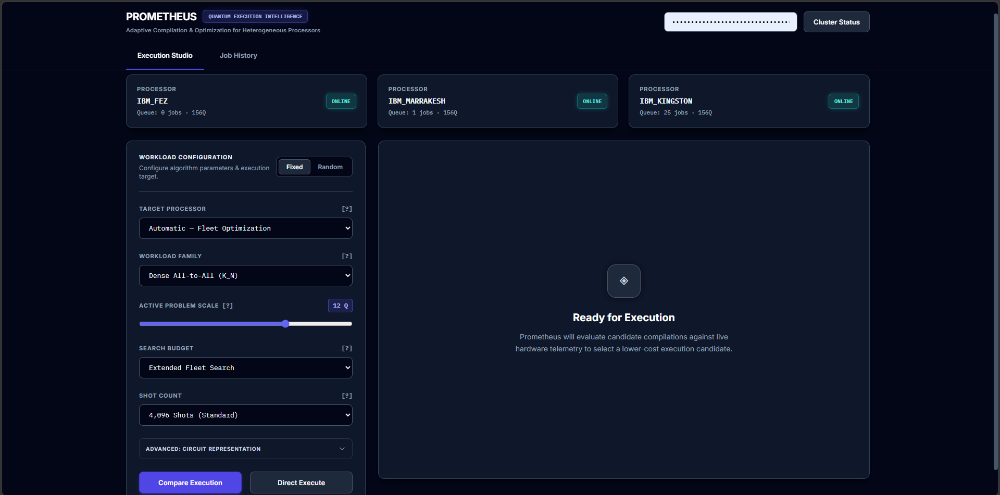](screenshots/01-studio-overview.png)
*Figure 01: Prometheus Execution Studio main dashboard and live cluster status header.*

### 02 - Target Processor Selection
[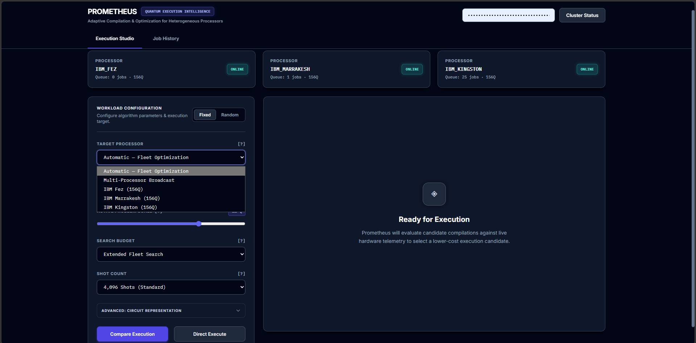](screenshots/02-target-processor.png)
*Figure 02: Target QPU selector supporting single-backend execution (`ibm_fez`, `ibm_marrakesh`, `ibm_kingston`) and multi-QPU broadcast.*

### 03 - Workload Family Selection
[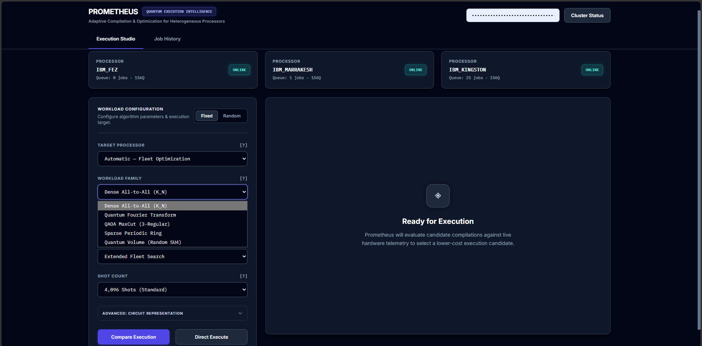](screenshots/03-workload-family.png)
*Figure 03: Benchmark circuit family selector (Dense All-to-All $K_N$, Quantum Volume, QFT, QAOA MaxCut).*

### 04 - Candidate Search Budget
[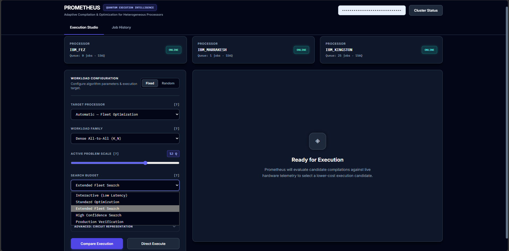](screenshots/04-search-budget.png)
*Figure 04: Hardware-aware candidate search budget configuration.*

### 05 - Hardware Shot Count
[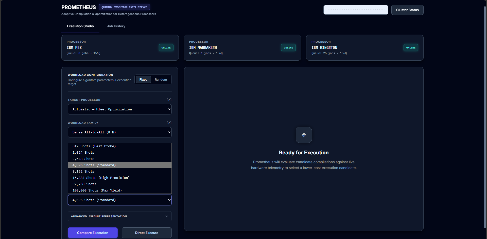](screenshots/05-shot-count.png)
*Figure 05: Per-circuit measurement shot count configuration (`1,024` to `100,000` shots).*

### 06 - Logical OpenQASM 2.0 Circuit Inspection
[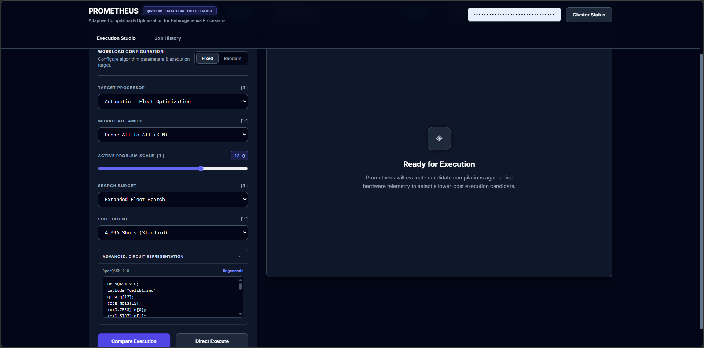](screenshots/06-logical-qasm.png)
*Figure 06: Logical OpenQASM 2.0 circuit inspection panel prior to compilation.*

---

## 2. Three-Way Hardware Benchmark: 9-Qubit Dense All-to-All ($K_9$) on `ibm_marrakesh` (`07` - `10`)

Screenshots `07`-`10` show the completed 3-way comparative execution (`SABRE O3` vs. `TKET` vs. `Prometheus`) for **9-Qubit Dense All-to-All ($K_9$)** on `ibm_marrakesh` (`Job ID: dadl5jd1ierc738l1420`, `4,096` shots/compiler = `12,288` total shots).

### 07 - 9Q Dense All-to-All (`dadl5jd1ierc738l1420`): 3-Way Measured Execution Results

*Figure 07: 9Q Dense All-to-All ($K_9$) on `ibm_marrakesh` (`Job ID: dadl5jd1ierc738l1420`, `4,096` shots/compiler) - Measured Execution Results: Distribution Fidelity $F_B$ (↑) `0.5738` (`SABRE O3`) vs. `0.5248` (`TKET`) vs. **`0.7466`** (`Prometheus`, **`+30.12%`**); HOP (↑) **`0.8425`** (`+14.80%`); TVD (↓) **`0.3015`** (`-34.04%`); XEB (↑) **`50.1079`** (`+30.76%`).*

### 08 - 9Q Dense All-to-All (`dadl5jd1ierc738l1420`): Hardware Allocation Panel
[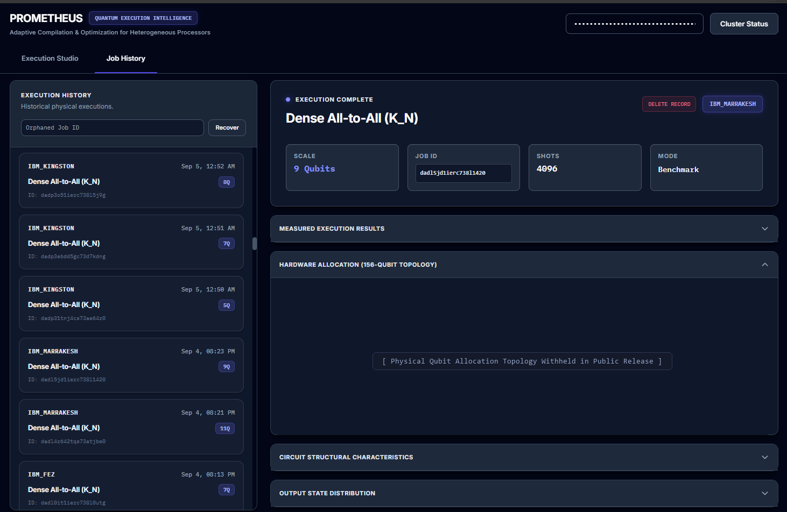](screenshots/08-qv-hardware-allocation.png)
*Figure 08: 9Q Dense All-to-All ($K_9$) on `ibm_marrakesh` (`Job ID: dadl5jd1ierc738l1420`) - 156-Qubit Hardware Allocation Panel (showing public release redaction of physical qubit coordinates).*

### 09 - 9Q Dense All-to-All (`dadl5jd1ierc738l1420`): Circuit Structural Characteristics
[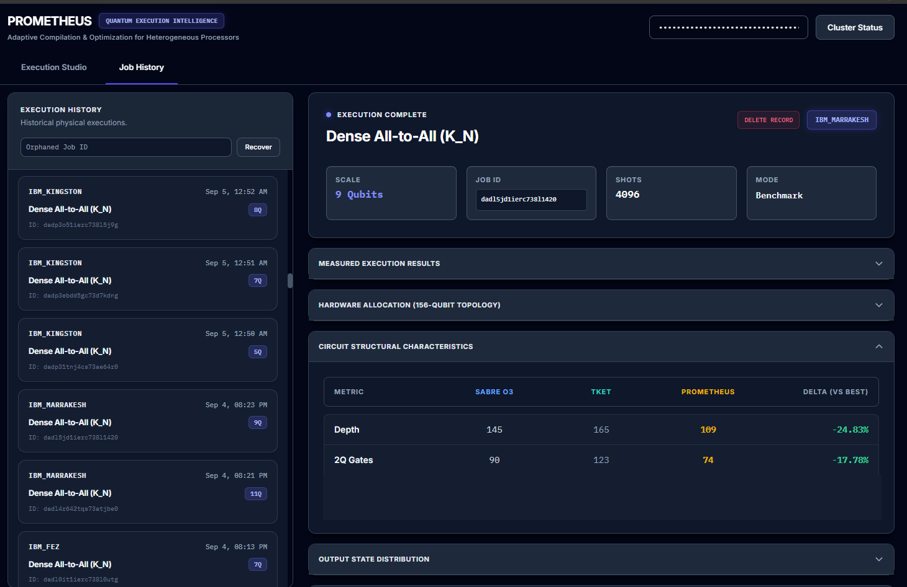](screenshots/09-qv-circuit-structural-characteristics.png)
*Figure 09: 9Q Dense All-to-All ($K_9$) on `ibm_marrakesh` (`Job ID: dadl5jd1ierc738l1420`) - Structural Comparison: Circuit Depth (↓) `145` (`SABRE O3`) / `165` (`TKET`) / **`109`** (`Prometheus`, **`-24.83%`**); Native 2Q Gates (↓) `90` (`SABRE O3`) / `123` (`TKET`) / **`74`** (`Prometheus`, **`-17.78%`**).*

### 10 - 9Q Dense All-to-All (`dadl5jd1ierc738l1420`): Output Bitstring Distribution
[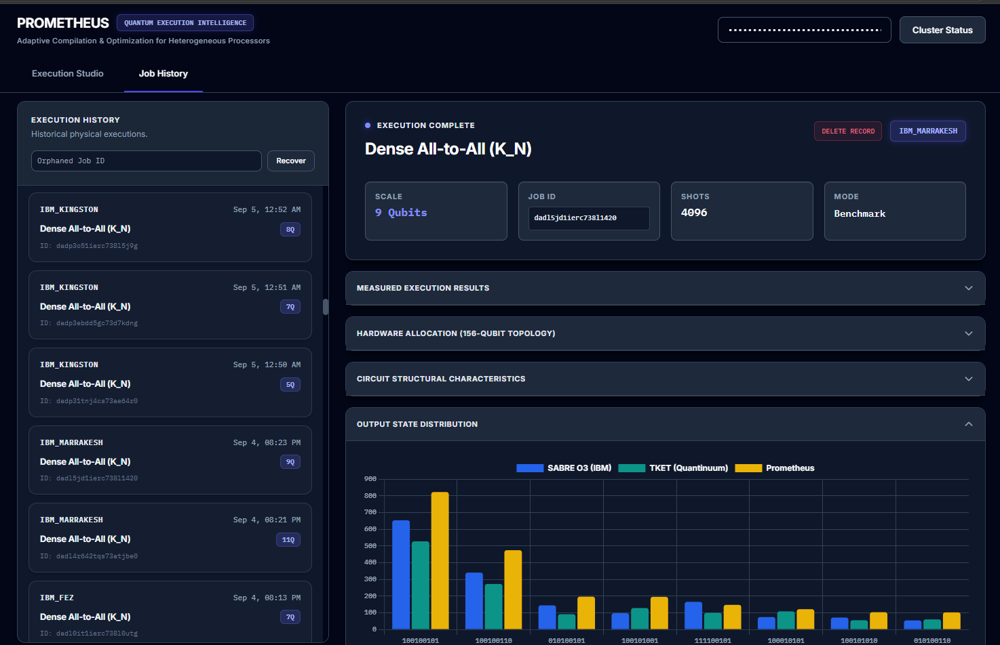](screenshots/10-qv-output-state-distribution.png)
*Figure 10: 9Q Dense All-to-All ($K_9$) on `ibm_marrakesh` (`Job ID: dadl5jd1ierc738l1420`, `4,096` shots/compiler) - Measured Z-Basis Bitstring Frequency Histogram comparing `SABRE O3` (blue), `TKET` (green), and `Prometheus` (gold).*

---

## 3. Quantum Volume (`Random SU(4)`): 8-Qubit Execution on `ibm_kingston` (`11`)

### 11 - 8Q Quantum Volume (`dabeu63vpcac73ddn40g`): Logical / Compiled OpenQASM Telemetry
[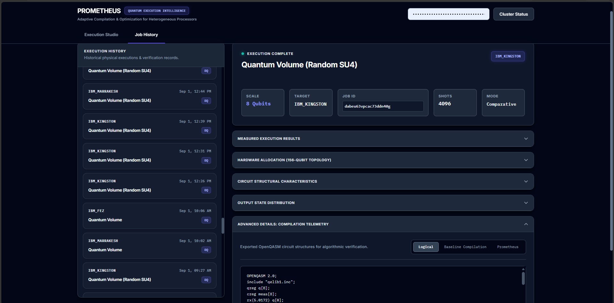](screenshots/11-qv-logical-compiled-qasm.png)
*Figure 11: 8-Qubit Quantum Volume (`Random SU(4)`) on `ibm_kingston` (`Job ID: dabeu63vpcac73ddn40g`, `4,096` shots) - Compilation Telemetry & Exported Logical OpenQASM 2.0 Verification View.*

---

## 4. Repeated-Execution Drift Controls: 9-Qubit Dense All-to-All on `ibm_marrakesh` (`12` - `14`)

Screenshots `12`-`14` document three consecutive 9-qubit Dense All-to-All ($K_9$) executions on `ibm_marrakesh` (`4,096` shots/circuit) illustrating run-to-run hardware fluctuation across back-to-back jobs:

### 12 - 9Q Dense All-to-All Drift Control 1 (`Job ID: dacloht1ierc738jq1f0`)
[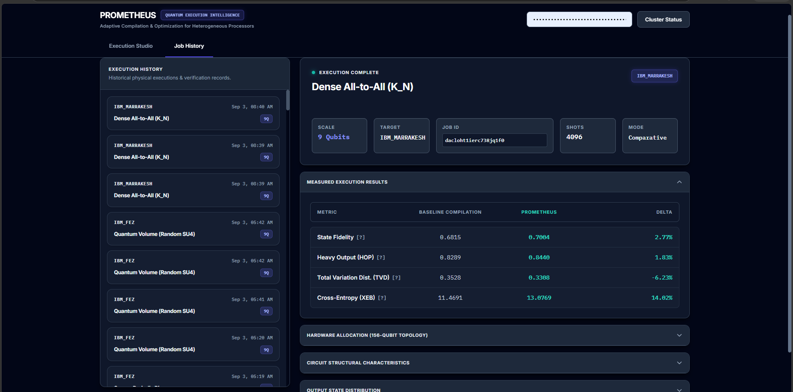](screenshots/12-dense-execution-drift-test1.png)
*Figure 12: 9Q Dense All-to-All ($K_9$) Repeated Run 1 on `ibm_marrakesh` (`Job ID: dacloht1ierc738jq1f0`, `4,096` shots) - Distribution Fidelity $F_B$ (↑): `0.6815` (Baseline) vs. **`0.7004`** (Prometheus, `+2.77%`); HOP `+1.83%`; TVD `-6.23%`; XEB `+14.02%`.*

### 13 - 9Q Dense All-to-All Drift Control 2 (`Job ID: dacloslnj4cs73acqh90`)

*Figure 13: 9Q Dense All-to-All ($K_9$) Repeated Run 2 on `ibm_marrakesh` (`Job ID: dacloslnj4cs73acqh90`, `4,096` shots) - Distribution Fidelity $F_B$ (↑): **`0.7067`** (Baseline) vs. `0.6752` (Prometheus, `-4.45%`), while Prometheus XEB (↑) is `12.7435` vs. `12.4700` (`+2.19%`). Retained as a run-to-run variability control.*

### 14 - 9Q Dense All-to-All Drift Control 3 (`Job ID: daclp3bdd5gc73d68lu0`)
[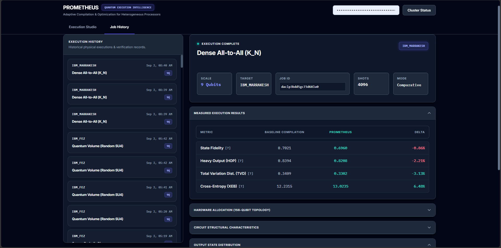](screenshots/14-dense-execution-drift-test3.png)
*Figure 14: 9Q Dense All-to-All ($K_9$) Repeated Run 3 on `ibm_marrakesh` (`Job ID: daclp3bdd5gc73d68lu0`, `4,096` shots) - Distribution Fidelity $F_B$ (↑): **`0.7021`** (Baseline) vs. `0.6960` (Prometheus, `-0.86%`), while Prometheus improves TVD (↓) to **`0.3302`** vs. `0.3409` (`-3.13%`) and XEB (↑) to **`13.0235`** vs. `12.2315` (`+6.48%`).*

---

## 5. Higher-Width (`12Q` - `16Q`) Dense All-to-All Comparisons (`15` - `18`)

### 15 - Dense All-to-All Comparison 1 (`+9.77%` Distribution Fidelity $F_B$)
[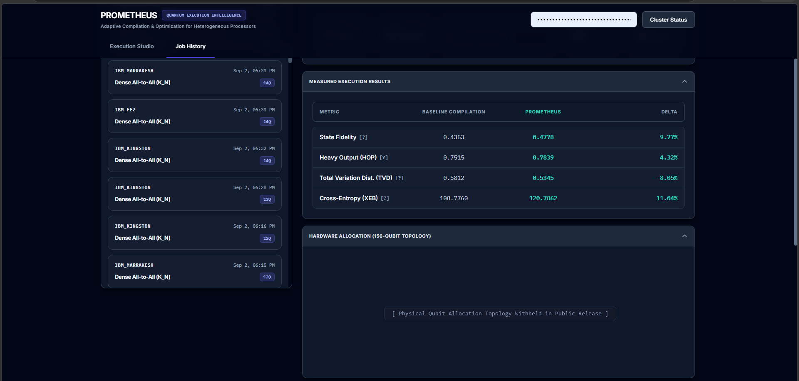](screenshots/15-observed-gains-topology-comparison1.png)
*Figure 15: Higher-width Dense All-to-All comparative execution (`12Q`-`14Q` history cohort) - Distribution Fidelity $F_B$ (↑): `0.4353` (Baseline) vs. **`0.4778`** (Prometheus, **`+9.77%`**); HOP (↑) **`0.7839`** (`+4.32%`); TVD (↓) **`0.5345`** (`-8.05%`); XEB (↑) **`120.7862`** (`+11.04%`).*

### 16 - Dense All-to-All Comparison 2 (`+9.83%` Distribution Fidelity $F_B$, `+26.55%` XEB)
[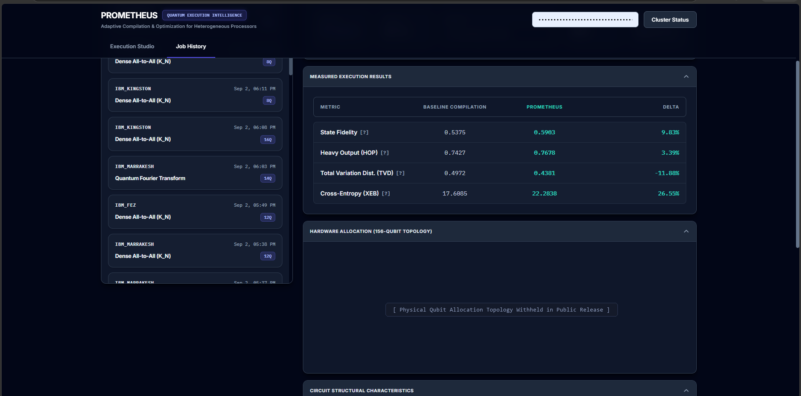](screenshots/16-observed-gains-topology-comparison2.png)
*Figure 16: Higher-width Dense All-to-All comparative execution - Distribution Fidelity $F_B$ (↑): `0.5375` (Baseline) vs. **`0.5903`** (Prometheus, **`+9.83%`**); HOP (↑) **`0.7678`** (`+3.39%`); TVD (↓) **`0.4381`** (`-11.88%`); XEB (↑) **`22.2838`** (`+26.55%`).*

### 17 - 12Q Dense All-to-All Comparison 3 on `ibm_marrakesh` (`+32.53%` Distribution Fidelity $F_B$)

*Figure 17: 12-Qubit Dense All-to-All ($K_{12}$) on `ibm_marrakesh` - Distribution Fidelity $F_B$ (↑): `0.4268` (Baseline) vs. **`0.5656`** (Prometheus, **`+32.53%`**); HOP (↑) **`0.7358`** (`+9.24%`); TVD (↓) **`0.4620`** (`-22.57%`); XEB (↑) **`400.5055`** vs. `278.4709` (**`+43.82%`**).*

### 18 - 12Q Dense All-to-All Comparison 3: Structural Depth & 2Q Gate Reduction
[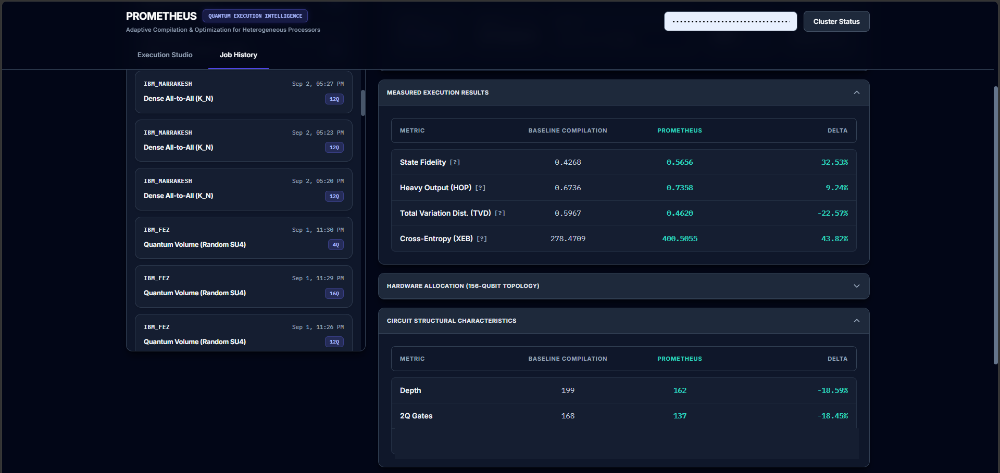](screenshots/18-observed-gains-topology-comparison3-depth-comparison.png)
*Figure 18: 12-Qubit Dense All-to-All ($K_{12}$) on `ibm_marrakesh` - Structural Characteristics: Circuit Depth (↓) `199` (Baseline) vs. **`162`** (Prometheus, **`-18.59%`**); Native 2Q Gates (↓) `168` (Baseline) vs. **`137`** (Prometheus, **`-18.45%`**).*
